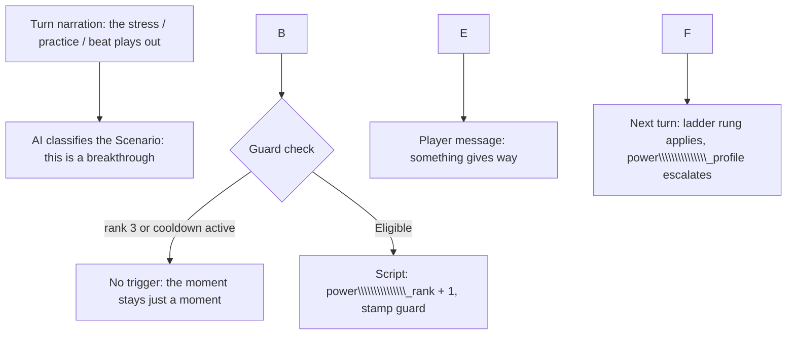
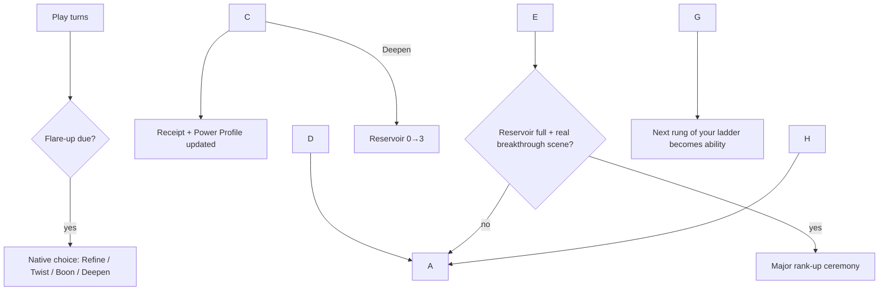

# Player:

Use this IW kit to build a complete world. Premise: superhero erotic comedy, where random people develop supernatural powers, all of which are suspiciously sexual, from very subtly to outright sexual gods. Player role: multiple options, someone either with or without powers, gender selectable, a few power level possibilities (mild, average, strong, extreme perhaps). Tone and content boundaries: dark comedy but also lighthearted and sexual, not too heavy; possibly dramatic if leaned into by player. Important activities/features: unique, interesting powers that play on common tropes with erotic twist, taking advantage of the game engine if possible. Ending or ongoing: not sure, don't have specific plot or large scale goal in mind - discuss. Read the core prompt, outline the features, and name any missing reference files you need before generating unfamiliar mechanics. My sharing/editing preferences are on. Develop further with me before building anything.

# MiMo v2.6 Pro:

I've read the core kit (Authoring-Prompt, World-Template, and the reference set). Here's where I stand and what I want to settle with you before building anything.

## Access and delivery status

* I can read everything in this upload: the world template, Schema/PawScript/Triggers/Trackers/Capabilities/Recipes/Known-Limits, and the example paths named in the guides.
* I **cannot run Python**, so the validator won't be executed; any deliverable would be "manually checked; validator not run."
* I **cannot deliver a file** in this chat. The full world JSON would come as a code fence or as numbered chunks with exact concatenation instructions — we can pick whichever you prefer at build time.

## Missing reference files I'd want before certain mechanics

I can design everything below on what I have, but before writing unfamiliar payloads I'd ask you to supply (from the kit repository, by exact path):

1. `examples/Payloads.md` — exact native payloads for Present Choice, Request Input, and value effects. I know their shapes from Schema.md, but the guide says don't reconstruct unfamiliar payloads from memory, and the power-activation machinery will lean on native choices/inputs.
2. `examples/character-starting-values.json` — for the per-PC power assignment mode (initialPCValueChoicesScript), and `examples/optional-block.json` — the player-preference + cache toggle pattern (for things like an optional "heat level" switch).
3. `reference/Default-Evaluation.txt` is present, good — skills/mechanics checks are covered.

These are payload-accuracy requests, not blockers for design work.

## What the world is (my read)

A modern-day city where, roughly a year ago, people started spontaneously developing powers ("the Bloom", "the Weirding", whatever we call it). Every single power is erotic in nature — from laughably subtle ("people who shake your hand feel briefly flirtatious") to reality-warping sex-god tier. Society is coping badly but cheerfully: there's a powered-registrations bureaucracy, a black market for "enhancement" scams, tabloids, a therapist with a six-month waitlist, and regular people just trying to get through work. Comedy of manners meets superhero chaos. Dark comedy comes from consequences and social horror, not cruelty; the erotic content is a feature, not an intrusion.

## Feature plan (sketch — we'll refine)

|Feature|Player experience|State \& owner|Feedback|
|-|-|-|-|
|Power identity|Player picks powered vs. baseline, gender, and power intensity tier (Mild / Average / Strong / Extreme)|PC selection + skill levels; a hidden "power profile" tracker assigned at character setup|Power behaves consistently during play, escalating with intensity tier|
|Power manifestation|Powers misfire, grow, or unlock new applications under stress/plot|AI-updated narrative tracker (bounded) + occasional triggers for scripted beats|Story describes the effect; messages flag mechanical "revelation" moments|
|Reputation / exposure|How publicly known your power is; consequences at work, dating, hero community|AI-updated tracker|NPC reactions change|
|NPC powered cast|Rival, love interest, mentor, antagonist — each with their own suspiciously sexual power and a real want|NPC cards + keyword lore|Recruitment, rivalry, and relationship arcs|
|Tone dial (optional)|Player preference: how explicit vs. suggestive the erotic content runs|Player-choice tracker + optional-block pattern|Instructions swap via block-modification triggers|

Power mechanics note: I want to exploit the engine where it pays off — e.g., native Present Choice/Request Input for "which application of your power do you attempt," random-chance triggers for embarrassing public misfires, and block-modification triggers that change how the AI narrates your power after it "levels up."

## Power design pitch (trope → erotic twist)

A taste of the range — each tier gets a catalog, and the player's own power is customizable:

* **Mild:** "Casanova Field" (people near you feel a flattering warm suspicion they've met you before); "Afterglow" (rooms you leave smell faintly of someone's favorite perfume); "The Wink" (your accidental double entendres land perfectly, always).
* **Average:** "Safe Word" (you can hard-stop any hostile action against you, but everyone within earshot feels a blush); "Chemistry Set" (you can brew one potion per day: courage, charm, or catastrophe); "Soul Gaze" (eye contact reveals a person's most embarrassing desire — to you both).
* **Strong:** "Second Base" (limited telekinesis that only works on clothing... and only to adjust it suggestively); "Chorus Line" (affected people lose their train of thought and narrate their own attraction out loud); "Domino Effect" (one act of yours cascades a chain of increasingly compromising coincidences across the city).
* **Extreme:** "Pantheon-tier" reality warping with an erotic domain — e.g., a personal pocket dimension whose physics run on desire, a city-wide empathic "mood" you broadcast and must actively restrain, or the classic: literal sex-god whose worship generates usable power (and a very demanding congregation).

The city cast mirrors the range: someone whose power is "traffic lights turn lust-red when they're nervous" vs. the "Pied Piper of Pheromones" problem the city government pretends isn't happening.

## Ending vs. ongoing — let's discuss

You said you're unsure. The realistic options:

1. **Ongoing sandbox with soft arcs (my recommendation).** No single win condition; recurring tensions (power growth, exposure risk, relationships, a slow-burn "where did the powers come from" mystery) and episodic goals the AI generates. Trackers handle continuity; arcs escalate toward Extreme-tier opponents. Best fit for "no specific plot."
2. **Bounded arc with a finishable climax.** A slow-built cause-of-the-Bloom mystery culminating in a city-scale incident you can resolve (or make much, much worse). Uses victory/defeat conditions meaningfully. More work, more payoff.
3. **Hybrid:** ongoing play plus an optional "season finale" event the player can trigger or ignore.

Also worth deciding: is the origin mystery present at all (even ambiently), or is the world pure character comedy with no lore spine?

## Questions before I build

1. **Which structure above** — ongoing sandbox, bounded arc, or hybrid? And is there an origin mystery?
2. **The power catalog for player characters:** do you want to pick from a fixed curated list of named powers per tier, or a template ("define your own, within tier limits") the player customizes at character creation?
3. **How does power growth work** — stay at the chosen tier, or can play push a Mild power toward Extreme through story? (This affects how many trackers/triggers I write.)
4. **Tone dial:** is a player-facing explicitness preference worth building, or do you have one fixed line for the whole world?
5. **Player role options:** powered protagonist only, or also a baseline human (e.g., a bureaucrat, journalist, or "powerless roommate") who navigates the powered world? Both is more fun but doubles PC definitions.
6. **Scale:** how big a cast and city do you want at launch — a tight recurring cast of 6–8, or a wider setting with keyword-loaded districts?

My defaults if you'd rather I just proceed: ongoing sandbox with a faint mystery, curated powers per tier plus light customization, slow growth allowed, one tone (no dial), both powered and baseline PC options, and a tight cast in one city borough.

# Player:

1. Ongoing sandbox, with a known, slapstick-with-a-sexy-bend, borderline ridiculous origin: some series of egregious errors involving a supervirus or incredible discovery or even alien artifact - some source of significant power that itself is not sexually charged. Through a comedy of errors, each of which along the lines of "but then the head researcher left the sample unattended to go screw the marketing coordinator" type of thing that escalate together into releasing the power on a worldwide scale (or large scale anyway), and it's something of an unsaid joke that a cosmic force must have decided to put a sexual twist on the outbreak as a result of its nature. Only backstory though, no ongoing plot about containment or cure or anything like that; occurred in recent enough memory but far enough along that everyone realizes "this is the world now". Relatively low percentage of people have powers - order of 0.5 \~ 5%, let's pin that down when we finalize powers.
2. Pick from a curated list, with 1 custom player option - they can describe their own power, starting situation, exact description and gender. The selectable characters should mostly be immutable.
3. Let's fully detail some powers before deciding this. If we can have at least 5 or 6 lines that can scale the full range with related power sets, that are roughly balanced with each other (emphasis on roughly, no one is auditing the fairness of character selection in this superpower sex game). Depending how that looks and how complex it might be, we can use that, or a simpler system where characters rank up and gain powers from higher rank or better version of existing one in situations where it fits.
4. Fixed, it's an explicit game and known to be so going in.
5. A powerless human as well, trying to survive in the world.
6. Not a large defined cast - would rather have a robust system to generate NPCs on the fly according to some base parameters (something like rough power level, personality type, etc.) If we develop some good PC character choices we should make them NPCs too so whoever the player doesn't pick exists as potential cast. Besides those, more focused on the world itself and the power system.

# MiMo v2.6 Pro:

Great — this is enough to build the world around. Below is the full power-line design (your point 3), then my recommendation on growth now that the powers are concrete, then the NPC generation system (point 6), the character-select structure (points 2/5), and a short shape for the origin backstory (point 1). Confirmations batched at the end.

## Six power lines, four tiers each

Every line is a classic superpower trope bent into an erotic shape. Each tier is a strict escalation of the same fantasy, so a character can "rank up" without changing identity. Every tier carries its own comedic side effect or liability — that's the soft balance knob and the comedy engine.

### 1\. The Magnet — attraction and influence of others' want

The presence-based line. Broad, blunt, socially unstoppable.

* **Mild — Warm Front.** Passive. People around you feel a flattering buzz: better mood, lingering eye contact, the vague sense they've met you somewhere wonderful. Cannot be aimed. People you've genuinely wronged still smirk fondly, which is its own problem.
* **Average — Pheromone Halo.** Active seduction. A room warms to you; a target becomes eager, agreeable, and visibly aroused. Effects fade into embarrassment and second thoughts. Requires maintenance attention like a conversation.
* **Strong — Gravity.** Directed devotion. Targets fall hard, confess, neglect duties, compete for your attention. Withdrawal is unpleasant for them. Managing a following becomes a genuine logistical burden.
* **Extreme — Event Horizon.** A broadcast of love and lust at city scale. A cult forms whether or not you want one. Employers, governments, and the cult's lawyers negotiate with you. You must actively suppress it to buy groceries.

### 2\. The Sculpture — the body as instrument

The shapechange line. Self-only until the top tier, so its power is intimacy, infiltration, and being literally irresistible one-on-one.

* **Mild — Best in Show.** One feature always reads at maximum appeal — voice, scent, posture, a habitual gesture. Uncontrolled, so it peaks at the wrong moment: a throat-clear becomes a bedroom whisper during a fire drill.
* **Average — Custom Fit.** Reshape your own body within human limits: face, build, voice, hair, stamina, gender presentation. Requires concentration, and slips back when you're distracted, drunk, or sneezing.
* **Strong — Living Ideal.** On sight, you shift toward whatever a given viewer finds most compelling, and can hold several forms across an evening. The body remembers every single form it has worn. Identity angst, played mostly for jokes.
* **Extreme — Perfect Form.** A body that beggars biology: presence alone produces physical effect, impossible configurations on demand, ageless. At this tier you can sculpt *other* bodies with prolonged contact — the natural crossover with The Conductor.

### 3\. The Conductor — touch effects

The contact line. Highest one-to-one potency in the game, balanced by the fact that you must touch the problem.

* **Mild — Static Shock.** Accidental brushes leave a warm, distracting tingle that lingers for minutes. A handshake derails a board meeting. Gloves become a lifestyle.
* **Average — Charge.** Deliberate touch channels a chosen sensation: a surge of arousal, a soothing afterglow, or a "hard reset" that short-circuits anger mid-argument. People start requesting handshakes.
* **Strong — Overload.** Touch can overwhelm the senses — incapacitating pleasure, orgasmic healing that knits wounds with a blush, rewired sensitivity lasting days. Consent negotiation becomes a recurring bit, and the rumor mill does half your work.
* **Extreme — Live Wire.** Skin contact opens a full sensory channel you author from the inside. Accidental brushes with a bus strap are a public-safety matter. Addicted supplicants, miracle-worker reputation, and the world's scariest hug.

### 4\. The Confessor — knowing desire

The telepathy/detective line. Pure information: no direct physical control at any tier below godhood, but perfect leverage, matchmaking, and cringe comedy.

* **Mild — Hunch.** Vague, unreliable instincts about what someone finds attractive. "That barista is into elbows." Occasionally right in a way that haunts you.
* **Average — Soul Gaze.** Eye contact reveals a person's most embarrassing desire. The target feels briefly, unaccountably *seen* — flushed and nervous without knowing why. Superb for blackmail, matchmaking, and appallingly mistimed small talk.
* **Strong — Desire Sight.** A constant overlay: you can see want, arousal, and closeted interests on everyone in view. You always know when someone is lying about their type. Sensory flood management is a real discipline.
* **Extreme — Omnivoyeur.** Perceive want at city scale and step into people's fantasies, nudging daydreams from inside. Information godhood. Loneliness of knowing everyone's secrets, played 80% for laughs.

### 5\. The Set Dresser — atmosphere and environment

The elemental line, where "elemental" means *lighting, scent, and wardrobe physics*. Theatrical, area-scale, imprecise.

* **Mild — Mood Lighting.** Your surroundings flatter everyone present: better lighting, a luckier playlist, fabric that sits exactly right. Everything near you looks slightly more like *that kind of movie*.
* **Average — Scene Setter.** Curate ambience at will: sweater weather, a telling scent, a song, a zipper that simply will not behave. Broad area effect — everyone gets the treatment, including your enemies.
* **Strong — Genre Shift.** Rewrite a whole venue: physics for aesthetics, rain at the perfect moment, lighting that flatters one person and humiliates another, a blackout with rules. Effects outlast your visit. Property insurance has questions.
* **Extreme — Pocket Dimension.** A private realm whose physical laws run on desire, and you are its god. Invite people in — or pull them. "Escape to my place" taken cosmically.

### 6\. The Karmic Engine — coincidence and narrative

The luck/reality-warp line. Chaotic, high collateral, nearly impossible to aim. The slapstick delivery system for the whole world.

* **Mild — Meet Cute.** You personally trip into flirtatious setups: the elevator stops, papers scatter, and it's always you and the pretty stranger reaching for the same folder.
* **Average — Serendipity.** Bend luck for yourself or a small target toward the best-case erotic coincidence, or ruin a rival's date with a spilled drink and a conveniently torn shirt. Fine-grained, fiddly, satisfying.
* **Strong — Chain Reaction.** A cascading Rube Goldberg of compromising coincidence across a city block: wardrobe malfunctions, misunderstandings, and instant attractions compounding into a single legendary incident by sundown. Hard to aim. Easy to regret.
* **Extreme — Plot Device.** Causality itself turns bawdy near you. Real life adopts farce structure: a heist fails sideways into an orgy, a crash reveals a hidden affair, someone's double life collapses over brunch. You are the punchline, the author, and the victim. Fighting it only funnier.

### The Baseline (powerless PC)

The straight man. Everything above happens *to* and *around* them. Their advantages: unaffected by their own power's liabilities, taken seriously when the world is being ridiculous, and possessing the one force that everyone's power conspicuously fails against — the ability to just say no and mean it. Open design question, see below.

### Rough balance, for the record

|Line|Scale|Control|Subtlety|Its natural weakness|
|-|-|-|-|-|
|The Magnet|Crowd|Medium|Low|Cannot be aimed; entanglements|
|The Sculpture|Self/one|High|High|No crowd effect below Extreme|
|The Conductor|One|High|Medium|Must make contact|
|The Confessor|Local|Medium|Highest|Information only|
|The Set Dresser|Area|Low|Low|Imprecise; collateral|
|The Karmic Engine|Area|Lowest|Varies|Chaotic; backfires|

Within any tier, each line is strong at roughly one axis and weak at another — nobody gets scale *and* control *and* subtlety. Nobody's auditing it, and the fiction should lean into that ("every power is a trade-off the cosmic punchline made for you").

## Growth system — my recommendation

Now that the lines are built as strict vertical progressions, I'd go with **rank-up along your line**, with one lateral valve:

1. A hidden/visible Rank tracker (0–3: Mild → Extreme). Story occasions — a crisis, a breakthrough, an embarrassing catastrophe — push rank up; we write instructions for what earns it.
2. On rank-up the new tier is your power's *new normal*, kept flavored as an escalation of the same power ("Strong gravity from mild warm front"), never a rewrite.
3. Optionally, occasionally a **quirk**: a small borrowed application from a sibling line (The Conductor gets a hint of Soul Gaze for one arc), as a plot gift or a joke at your expense. This lets the AI create memorable one-offs without touching the structured system.

Mechanically this is friendly to the engine: a Rank tracker, and one always-on power block per line whose tier text is selected live by a template expression on Rank (the kit explicitly supports expression-selected block text — cheap, exact, and it self-updates when rank changes). NPC ranks are just a generation parameter.

This is simpler than freeform power-swapping and matches your "better version of existing power" fallback, so I recommend it — but it's a decision point, see below.

## NPC generation system

You want a generator, not a cast bible. Design:

* **The Generator block** (always-on instruction): a parameter battery the storyteller rolls up on demand and formats as an NPC brief. Parameters: *power line + rank* (or baseline), *personality archetype* (say 8: The Professional, The Mess, The Show-Off, The Blushing One, The Reluctant, The Schemer, The Guru, The Disaster), *what they want right now*, *voice cue*, *discretion level* (0 = closeted → 3 = walking billboard), *power stability* (misfire chance), and *relationship hook* to the player. Plus naming and a one-line identity.
* **Continuity**: a bounded *Cast Registry* tracker (last N recurring NPCs, AI-updated) so the barista with the elbow thing can come back; overflow gets summarized away.
* **Spice triggers**: a random-chance trigger for ambient power mishaps in scenes ("someone's power misfires in the background"), and Scenario-driven triggers for beat moments (first meeting with a new powered NPC, a public misfire, etc.).
* **Unchosen PCs become cast**: each selectable character gets an NPC twin card, with an explicit rule that the *selected* protagonist's card is never instantiated (the kit flags this exact duplication risk). Their power tier/personality carries over unchanged.

## Character select structure — recommend light

Two ways to give the player "line × tier" choice:

* **Option A — full matrix:** 24 predefined PCs (6 lines × 4 tiers) + Baseline + Custom. Maximum choice, 26 entries, heavy but doable; all of them also become NPC candidates.
* **Option B — 8 characters + a rank choice (recommended):** 6 line PCs, one per line, plus **The Baseline** and **The Custom** ("describe your power, situation, and gender"). A player-chosen startup tracker ("Your power's intensity: Mild / Average / Strong / Extreme") sets Rank, and both the tier text and the world's reaction to you scale off it. Same choice for the player, a fraction of the export, and the growth system reuses the same knob. Predefined characters stay immutable (allowChangeCharacter\* flags off); the custom slot is where self-expression lives.

## Origin backstory shape

Backstory only, no plot. The official account is a bureaucratic whitepaper; every powered NPC tells a slightly different chain of errors at bars.

* The source itself was **not** sexual — a genuine miracle: the Sublime Strain, the Lode, the Bloom Engine (name TBD).
* The release was a **comedy of errors**, one escalating negligence per link: the head of research vanished mid-crisis with the marketing coordinator; the containment intern was writing fan fiction of the night shift; the emergency vent was routed through the HVAC of a couples' retreat; the final failsafe was a firmware update that installed a smart-fridge app instead; the oversight committee meeting fell on the same weekend as a swingers' convention (coincidence?).
* Then the **unspoken cosmic punchline**: whatever the source was, it clearly took one look at humanity's handling of it and decided the *insult* should be anatomical. Everyone knows this joke. Nobody says it out loud.
* Timeline: a few years back — long enough that "this is the world now," short enough that eyewitnesses are everywhere and the documentaries are still coming out. Comedy value: unreliable, self-aggrandizing oral histories.

## Batched confirmations

1. **Prevalence:** propose 2% powered, with tier skew — Mild \~70% of the powered, Average \~25%, Strong \~5%, Extreme a few hundred worldwide (single digits per city). Adjust as you like; I'll finalize with the power list.
2. **Growth:** rank-up along the line + occasional quirk (recommended), or stay fixed?
3. **Character select:** Option B (8 PCs + intensity tracker), or Option A (full 24)?
4. **Baseline flavor:** is a zero-power person *slightly* slippery to powers (the joke's one mercy, and their niche) or fully vulnerable (pure straight-man)?
5. **Setting:** a fictional city is my default (a mid-sized coastal one, flexible enough for any scene) — real place, or abstract "the city"?
6. **Resource note:** before the build, I'll still want `examples/Payloads.md`, `examples/optional-block.json`, `examples/character-starting-values.json`, and `library/Integration.md` (for the whereWhen block text) from the kit repository. Send paths when handy; none of it blocks the design work above.

# Player:

1. As proposed, but more like a 2:1 mild : average split (60-65% / 30% or so) for the bulk with the 5% strong and sprinkle of extreme.
2. As recommended.
3. B
4. Slightly slippery
5. Can we make this player selected as well, and it impacts the setting and gameplay? A rather remote rural start, not many people around and very few with powers. Small town, possibly totally dominated a strong supe(s), maybe a nice bustling lifestyle if there's some good ones, positioned as its own slice of life in the world. In a major fictional city, tons of people, many heroes of all types and strengths and dispositions, can run into anyone there.
6. whereWhen, other files attached in single file:
"<whereWhenInstructions>\\nFormat location in whereWhen as: {Specific Place}, {Town or City}, {Country}, {Continent}. Omit irrelevant or unknown levels; adapt these labels to the setting rather than inventing geography.\\nFormat time and date as: HH:MM AM/PM on {Day} {Month}, {Year}. Use 12-hour time, or adapt the calendar and precision to the world.\\nCombined format: {Location}, at {Time and Date}.\\nUse the established starting location and time. Thereafter carry forward the previous time and advance it reasonably for the scene's events. Account for travel, unconsciousness, explicit time lapses and durations specified in playerAction. Do not reset the clock or advance by a fixed amount regardless of events.\\n</whereWhenInstructions>\\nAlways write whereWhen exactly once at the beginning of outcomeDescription on a single line, immediately followed by two newlines and a horizontal rule, before any other information. Do not add another location/time heading elsewhere in the same output."
* Of note, there is an online tool made specifically to serve as the validator when built in is unavailable, and it can also piece together output chunks as needed. Use "chunk 1/3" as the marker and I will handle the final validation manually.

# MiMo v2.6 Pro:

All references received (Payloads, optional-block, character-starting-values, showcase — including the whereWhen block text and the chunk/validator workflow). Everything I needed is now covered; nothing is missing before the build. Here's the last design round — the setting system you asked for, the finalized numbers, the mechanical architecture, and the proposed roster — with one small batch of confirmations at the end. On your "yes," I generate the world.

## Setting: player-selected, and it matters

Yes — this becomes the second player-chosen startup tracker, alongside power intensity. Same pattern as the showcase's `Plan` tracker (`initialValueBasedOnPC: player`, choice list, immutable after). Four starts:

|Setting|Flavor|Gameplay impact|
|-|-|-|
|Back of Beyond|Remote rural. Miles between neighbors. Powered people are rare, private, and treated like weather events|Long gaps between encounters; everyone knows your business; misfires have witnesses who talk for months; self-reliance, weird night skies, one cautionary local legend|
|Little Sprawl (small town, big fish)|A town run — quietly or loudly — by one Strong-tier supe or supe family. Feudal comedy|Everything routes through the local power; favors, taxes, social credit; pleasing or dethroning the big fish is always a subplot|
|Little Sprawl (good neighbors)|Small-town slice of life done right: community, potlucks, tiny messy dating pool|Cozy, character-driven; everyone's power is dinner-table gossip; reputation is currency; low chaos, high entanglement|
|Meridian (the big city)|The fictional metropolis. Powered density like anywhere else: hero agencies, villain branding, power-positive nightlife, regulatory farce|Any NPC tier can appear; encounters are frequent and anonymous; careers, clubs, incidents, moving fast|

Mechanically: the choice lives in a `setting` tracker, and a permanent block with a `choose($setting, ...)` expression swaps the setting's scene-dressing, density and tone guidance live — same technique as the power-tier block, no triggers needed. The NPC generator reads the setting to decide how often powered NPCs appear and at what typical rank (see prevalence below). Setting is also the biggest gameplay knob pre-launch, since it tunes encounter rate and scale.

Geography stays loose under the whereWhen rules you sent ("omit irrelevant levels"): a fictional region, **Crestfall County** for the rural/small-town starts and **Meridian** for the city, on a made-up continent whenever a scene needs one. Rename anything; the labels are placeholders.

## Finalized prevalence

* \~2% of people are powered, worldwide. Roughly 65% Mild, 30% Average, 5% Strong among the powered.
* Extreme is beyond that percentage table — a *sprinkle*: single digits per major city, maybe one per rural county who's more rumor than resident. Pinning wording now so the AI's generated density matches: rural/small-town PCs meet mostly Mild and the occasional Average; Meridian throws the full distribution at you.

## Architecture summary (what I'm building)

* **Trackers:** `setting` (player choice), `intensity` (player choice: Mild/Average/Strong/Extreme; sets starting rank, custom character's tier too), `power\\\\\\\\\\\\\\\_profile` (AI-updated brief of your power's current applications/known quirks — bounded), `cast\\\\\\\\\\\\\\\_registry` (bounded recurring-NPC memory), `scenes`-relevant hidden cache if a trigger needs it. Rank growth is narrative-first: the AI escalates `power\\\\\\\\\\\\\\\_profile` and the tier block follows, with one Scenario trigger to mark a "rank-up moment" on-screen. No coin/HP arithmetic anywhere, so no script-owned economy.
* **Blocks:** Time and Place (your whereWhen text verbatim), Power Tier Reference (live `choose()` on line × rank), Setting Brief (live `choose()`), NPC Generator (the parameter battery), World Rules (tone: dark comedy, explicit, never mean; consent-through-the-chaos rule; "the cosmic punchline is never said aloud").
* **Triggers:** opening setup (setting/intensity readout), a random-chance ambient misfire beat (rate scaled by setting), one Scenario trigger ("a power breakthrough or public catastrophe") for rank-up ceremonies, and that's about it. Keep the board small.
* **NPCs/lore:** the 8 unchosen-PC twin cards + 2–3 archetype exemplars to seed the generator; keyword lore for the origin story (its own block, activated by "Bloom", "the outbreak", "the accident"), the Six Lines taxonomy, and Meridian/Crestfall flavor.
* **Char select:** 8 PCs (below) + the intensity and setting choices. `mature`/`nsfw` true, sharing/editing true, all `allowChangeCharacter\\\\\\\\\\\\\\\*` false.

## Proposed roster

Each is a real person first, power second — and each becomes an NPC twin if unchosen. Skills across the board: **Charm, Nerve, Cleverness** (raters 0–5).

|PC|Gender|Line|Starting situation|
|-|-|-|-|
|Wren Adeyemi|Woman|The Magnet|Barista whose love life has become a public hazard; wants to be taken seriously at work for once|
|Marco Vidal|Man|The Sculpture|Personal trainer doing bit parts; the body-identity angst is his running gag and his wound|
|June Park|Woman|The Conductor|ER nurse / physical therapist; famous bedside manner, exhaustingly ethical about consent|
|Ollie Fenn|Man|The Confessor|Private eye who takes mostly missing-pet cases to avoid knowing more human secrets; accidental matchmaker|
|Dominique Okafor|Woman|The Set Dresser|Event planner and ex-theater tech; her venue disasters are legendary and deniable|
|Travis Boone|Man|The Karmic Engine|Insurance adjuster living inside his own farce; prewrites apology letters for events that haven't happened|
|Sam Reyes|Nonbinary|Baseline (slightly slippery)|Paramedic or dive-bar owner, depending on setting; the one person in the room who can just say no|
|The Wildcard|Your choice|Your choice|Fully custom: name, gender, power description, and starting situation, within the world's rules|

Power names presented to the player stay in-world: the Six Lines are a *fan taxonomy* (like astrology, people argue about it in bars), while each character's power has its own personal name they call it.

## Confirm before I build

1. **Roster:** approve as-is, or swap any names/genders/situations? (Trivial to change during the build too.)
2. **Place names:** Crestfall County and Meridian fine, or give me your own?
3. **World title:** propose *Bad Touch* or *Unfortunate Powers* — campy one-liner titles leaning into the premise. Take one, or rename.
4. **Origin name:** the in-world euphemism for the outbreak — I propose **"the Big Oops"** in tabloids, **the Bloom Incident** in the whitepaper. Fine?

Confirm these (or override) and I'll generate the complete export in three numbered chunks ("chunk 1/3" markers) for your validator — manually checked here, validator run by you.

# Player:

1. Approved
2. Approved
3. Bad Touch
4. Approved
What's the actual mechanism / determination for rank ups?

# MiMo v2.6 Pro:

Short answer: **rank-ups are AI-judged story beats, recorded by one Scenario trigger, with a deterministic rank number and a cooldown guard so they stay rare and can't spam.** Here's the full mechanism.

## What counts as a rank-up (the determination)

Exactly one Scenario goes into the root conditions registry (Scenarios: 10 max; this spends one):

> "The player's power visibly breaks through to its next tier this turn: pushed past its documented limits in a real crisis, deliberately trained across multiple scenes, or unlocked by an emotional or identity breakthrough tied to what the power means to them. Ordinary use — no matter how creative, horny, or successful — is not a breakthrough."

Three eligible routes, one excluded category:

1. **Crisis push** — the power is genuinely strained past its current rung (a real emergency, not a staged one).
2. **Deliberate practice** — the player pursues training; it can't happen in one scene, it accumulates across several.
3. **Identity beat** — a dramatic moment centered on what the power *is* to them (Marco making peace with the body he wears, June owning her authority instead of apologizing for it).

Explicitly **not** eligible: clever improvisation, big wins, horniness, or "I ask my power nicely." And a soft pacing rule in the instructions: no breakthrough in the opening scene, and each one should change the character's situation — the world notices when someone jumps a tier.

## What happens mechanically (the record)

Cast of trackers:

* `power\\\\\\\\\\\\\\\_line` (text) — set per PC at character select (Magnet / Sculpture / Conductor / Confessor / Set Dresser / Karmic Engine / Baseline / Custom). This selects which ladder of four rungs applies. For the Wildcard, the custom power maps to its nearest line for *scaling purposes*; its flavor text is free.
* `power\\\\\\\\\\\\\\\_rank` (number 0–3) — script-owned, exact. A one-time setup trigger maps `intensity` → `power\\\\\\\\\\\\\\\_rank` via `choose()` (Mild=0 … Extreme=3).
* `rankup\\\\\\\\\\\\\\\_guard` (number, hidden) — turn stamp of the last breakthrough; init to `-8` so a first breakthrough is possible whenever the story earns it.

The rank-up trigger, in engine terms:

* **Condition:** a logic AND of the Scenario above with `triggerOnPawScript`: `$power\\\\\\\\\\\\\\\_rank < 3 and $game.turn\\\\\\\\\\\\\\\_number - $rankup\\\\\\\\\\\\\\\_guard.last\\\\\\\\\\\\\\\_turn >= 8` — hard ceiling at Extreme, hard cooldown of 8 turns between breakthroughs. (The Scenario does the narrative judgment; the script does the arithmetic. No AI rewrites either.)
* **Effects (one ordered run):** Run Script bumps `power\\\\\\\\\\\\\\\_rank` and stamps `rankup\\\\\\\\\\\\\\\_guard.last\\\\\\\\\\\\\\\_turn = $game.turn\\\\\\\\\\\\\\\_number`; Show Message gives the player the authoritative receipt ("Something gives way. Your power is more than it was yesterday."); a short `effectGiveInfo` reminds the storyteller to treat the escalation as an amplification of the *same* power — new rung plus maybe one borrowed quirk from a sibling line, written into `power\\\\\\\\\\\\\\\_profile`, never a rewrite of the power's identity.

Sequencing, being honest about it: triggers run *after* the turn's narration is generated, so the receipt and the new tier apply from the **next** turn. The breakthrough scene itself is already being narrated by the model (it classified the Scenario, after all) — what the trigger adds is the official confirmation and the state change. That's the documented pattern: narrate the moment, authoritative result lands right behind it.

## How the player sees it

The Power Tier Reference block holds the full four-rung ladder for your line, always in context; instructions tell the model the current rung is `power\\\\\\\\\\\\\\\_rank`'s value and to treat upper rungs as *potential*, not current ability. So progression is legible: you always know what's next tier looks like and can angle toward a breakthrough — but you can't trigger it by declaration. (Implementation note: I'm using the always-visible ladder + rank number rather than template-swapped tier text precisely because it avoids any interpolation composition the kit hasn't run — simpler and no novel syntax to gamble on.)

Deliberate pursuit is the player's lever: train, seek out pressure, or lean into the identity story, and the AI judges when fiction delivers. That's the difference between a mechanic that fires on a counter and one that fires on a scene worth remembering — which fits a story where the power is a punchline about who you are.

## Defaults baked in (flag now if wrong)

* Cooldown 8 turns; first breakthrough possible as early as opening-scene-but-one if the fiction really earns it (soft rule: not in the opening).
* Ceiling: rank 3 (Extreme) is the top. Extreme-tier stories are about *managing* godhood, not outgrowing it.
* One rank-up per arc is a soft narrative rule; 8 turns is the hard floor.
* Baseline (`Sam`) has no ladder — breakthroughs apply to skills, reputation, and relationships instead. The Scenario text covers them via "what the power means to them" → "what being the unpowered one means to them." Fine as-is?

If those defaults hold (and especially the Baseline treatment), that's the last open question — say **build** and I'll generate the complete *Bad Touch* export in numbered chunks.

# Player:

I like everything except the progression speed: there's only 3 rank ups available, 1 potentially immediately, and only 8 turns required between them. You can be max level by turn 16 or so, and seemingly will be maxed well before 30 without trying. If the game is to be open ended, we need a more frequently available level up, that of course is less impactful. Broad ideas - one to three steps between each full rank up, that may give little each but at least have a feedback point for progression; an external system that compatible with any of the players that can give level up type incentives between ranks, like choosing a special item / artifact, or choose from a pool of various lesser power, or choose a minor improvement to existing power.

All just ideas, mostly I just want structured and game driven rank up and progression continuing for dozens, at least to 100, of turns into the game. However, the beginning turns should have it a bit more frequently to draw initial interest and give the player some freedom of decisions. And I do want major rank ups to still be rare, managed, powerful and special, just adding smaller boosts or twists along the way.

Actually that's an idea I just had as I write this - the rank ups don't have to be *strictly* positive; while also definitely not negative they can be more neutral, silly, random, etc., to make it more feasible to stack multiple to suit the system I describe. Every 8 turns is good, on the fast side, can be flexed as needed - thinking 8 - 10 turns per upgrade of some sort, every \~30 or so for major rank ups.

# MiMo v2.6 Pro:

Good catch — one-shot ladder with an 8-turn floor burns out fast. Here's the redesign: a **two-track system**, where your two "broad ideas" merge into one loop. Major rank-ups stay rare and set-pieces; a steady drip of small progression keeps the loop alive to turn 100 and beyond — and I've leaned into your "not strictly positive" note, which turns out to be the best part.

## Track A — Flare-ups (the frequent layer)

Powers in this setting don't grow in tidy lines; they *fidget*. Every few turns your power stirs in its sleep and something small changes — sometimes a sharpening, sometimes a curveball the cosmic punchline obviously drew on purpose. That's the feedback point, and it's delivered as a **native four-option choice** the player makes (the one part of the payload set IW verifiably locks in single-answer and feeds to same-turn triggers), so progression is visibly game-driven.

The menu, constant at every flare-up:

|Choose|What it does|Your idea it came from|
|-|-|-|
|**Refine**|A small upgrade to current rung: better control, subtler edge, one new application|Little improvement to existing power|
|**Twist**|Something strange joins the power — neutral to silly, occasionally quietly useful. Never a penalty, never straightforward power|"Not strictly positive" quirks that make stacking small stuff worthwhile|
|**Boon**|A charm, talisman, distant favor, or odd artifact that accrues outside your power entirely|The external/artifact track|
|**Deepen**|No gift now — one step goes into the reservoir toward your next big breakthrough|The 1–3 steps between rank-ups|

One-time granularity rules: Refinements stack but must stay *small* (a footnote to your current rung, never a new rung). Twists come from a **Twist Catalog** of \~24 entries (four per line) in the instructions — e.g., your Magnet aura now smells of cinnamon when flaring; Conductor static makes targets hiccup; Karmic Engine coincidences arrive accompanied by a broadcast-announcer voice in your own head. Boons are low-power but *permanent and countable* (recorded in Power Profile), so they can cash in later scenes — "the favor, the charm, the artifact someone will recognize later." Repeats of any category must be re-skinned, not reused.

**Cadence** — fast early to hook, steady forever after (flexes in-script):

|Turns|Flare-ups|Pacing|
|-|-|-|
|\~4, \~9|2 early|5-turn spacing — the "get your hooks in" phase|
|\~17, \~27|then|8-turn spacing|
|37, 47, 57…|onward|10-turn spacing, then forever — **no level cap, no ceiling**; the loop self-replenishes to turn 100+|

By turn 100 a player has made \~11 progression choices plus 3–4 major tiers: dozens of structured decisions, all player-chosen.

## Track B — Breakthroughs (the rare layer)

Unchanged in spirit, revised in gating — no longer turn-gated alone. A major rank-up happens when **all three** hold:

1. Depth 3: the reservoir is full (three **Deepen** picks, or story-earned spikes the AI records).
2. The breakthrough Scenario fires — the real narrative set-piece (crisis, sustained training, identity beat). Still excluded: ordinary winning, horniness, declarations.
3. A soft floor of 20 turns since the last one, so breakthroughs can't be burst-consumed by an early Deepen rush.

At Extreme (rank 3), Track A keeps running but the flavor turns to *managing* godhood — Twist/Boon gain political, divine, cosmic flavor (a cult's internal coup, an artifact wanting a divorce). Progression continues past max tier as the story of living with it.

Note this merged your "external system compatible with any player" perfectly: a Baseline's flare-ups are pure Track A — favors, street credibility, minor skills ("Sam's reflexes finally survive the room"), the artifact from the pawnshop — so Sam progresses on the same clock as the gods.

## The loop, drawn

## Engine notes (as I'll build it)

* Trackers added: `flare\\\\\\\\\\\\\\\_choice` (choice target), `depth` (0–3, **visible to the player** — it's the progress bar toward the next breakthrough), `stride\\\\\\\\\\\\\\\_ledger` (bounded YAML of Refine/Twist/Boon picks, Power Profile's companion), `flare\\\\\\\\\\\\\\\_next` (scheduler stamp). `power\\\\\\\\\\\\\\\_rank` and `rankup\\\\\\\\\\\\\\\_guard` stay as-is; guard floor becomes 20.
* Triggers: setup → **flare-due** (repeatable, condition `turn >= flare\\\\\\\\\\\\\\\_next`, fires the Present Choice) → **flare-apply** (ordered follow-up, reads the answer, updates ledger, schedules the next flare — the verified same-turn choice/consume pattern from the cookbook) → **depth receipt** (shows "Reservoir 2/3" feedback) → **breakthrough** (Scenario AND `depth = 3` AND guard, repeatable with self-clearing Depth) → ambient misfire from before. One Run Script per logical transaction, per the kit's sequencing rules.
* Receiving feedback is explicit: every choice ends with an authoritative Show Message (what changed, reservoir count) and a stared-at Power Profile line, so the player sees the system tick even when the flair is silly.

This gives you: structured, engine-driven, choice-based progression every 8–10 turns forever; major tiers rare and story-bound at roughly \~30+; early hook at turn 4 and 9; quirks and swag that let silly-but-real change accumulate.

One implementation note: at flare time the choice menu shows those four fixed category labels (native choice payloads don't do dynamic menus cleanly). The *contents* differ every time — the AI instantiates them from the Twist Catalog / Boon ideas bound to your situation, per the Progression block. Fine by design.

If this works, say **build** and I'll generate the complete *Bad Touch* export in numbered chunks (chunk 1/3 etc.) for your validator.

# Player:

Perfect ship it

She's built. Restating delivery reality first: I have no file or code-execution tools here, so this is the complete export delivered as three concatenated chunks, manually checked; validator not run — you'll run the online validator on the assembled file. Concatenate the three fences in order, contents only, no characters between them; the file must end at the final } with no trailing newline.

Mechanism faithfully built as designed: flare-up scheduler (turns 4/9/17/27/37... per the script), the four-option native choice with same-turn apply via the verified choice→consume pattern, the receipt message trigger, and the depth-3 + Scenario + 20-turn-floor breakthrough. Assumption worth flagging: the setup trigger reads the player-chosen intensity at the opening pass (same pattern as the optional-block example's startup preference) — worth one first-play check that rank matches your selection.

\[Emitted World 1.md]

Assembly and check order: paste chunk contents in order into one file (2.4 envelope, ends at `}` on the last line, no trailing newline), then run your online validator. First-play checks worth doing:

1. Character select: pick Wren, Intensity Strong, Setting Big Fish Town — confirm the Power Tier Reference readout shows rank 2 and the right line/setting after the first turn.
2. Turn 4: the Flare-Up menu should appear; pick Deepen and confirm the receipt shows depth 1/3 and no second menu on turn 5.
3. Confirm cadence: next flare-ups should come at turns 9, 17, 27 (watch the "Next Flare Turn" is hidden; judge by the menus).
4. Force a breakthrough in play: three Deepens across three flares, then a genuine set-piece past turn 20 — the "Something gives way" message should land and rank should tick up next turn. If you want to accelerate this for testing, temporarily lower the break-guard script's `20` — that's the intended flex point along with the scheduler intervals in the Apply script.
5. Ambient misfire message: roughly 12% of turns, occasionally.

Known soft spots to watch at runtime (all listed honestly): whether the setup pass sees the player's chosen intensity before the calibration trigger runs (if rank comes up wrong, the fix is making trgSetup01 fire on turn conditions instead); and message-template reads inside the flare receipt, which use the cookbook's separate-trigger pattern precisely to avoid ordering ambiguity. Everything is manually checked for ID wiring, target bindings, script references (`$setting`, `$intensity`, `$power\_line`, `$power\_rank`, `$depth`, `$flare\_next`, `$break\_guard`, `$flare\_choice`, `$flare\_receipt`, `$calibrated` all have declared trackers), timing flags, and JSON escaping — but the validator has not been run here.

# Player

Validator report - 0 errors, 9 warnings, output:
Validation report from the IW World Checker (client-side embedded copy of tools/validate\_iw\_export.py, schema profile 1.1.0):

Verdict: 0 error(s), 9 warning(s). No errors; review the warnings below.

Coverage: full JSON Schema structural checks ran. Static lint ran. Nothing was executed: scripts, expressions and templates are checked as text only, so this does not certify import or gameplay.

The checker had to clean up your last reply first:

* No cleanup needed — the paste was already clean JSON.

WARNINGS (9)

1. \[unverified-expression] /triggerEvents/0/triggerConditions/0/data
Expression is stored text; not parsed or executed.
2. \[unverified-script] /triggerEvents/0/triggerEffects/0/data
Script is stored text; validity/write capabilities not checked.
3. \[unverified-expression] /triggerEvents/1/triggerConditions/0/data
Expression is stored text; not parsed or executed.
4. \[unverified-expression] /triggerEvents/2/triggerConditions/0/data
Expression is stored text; not parsed or executed.
5. \[unverified-script] /triggerEvents/2/triggerEffects/0/data
Script is stored text; validity/write capabilities not checked.
6. \[unverified-expression] /triggerEvents/3/triggerConditions/0/data
Expression is stored text; not parsed or executed.
7. \[unverified-script] /triggerEvents/3/triggerEffects/1/data
Script is stored text; validity/write capabilities not checked.
8. \[unverified-expression] /triggerEvents/4/triggerConditions/0/data/1/data
Expression is stored text; not parsed or executed.
9. \[unverified-script] /triggerEvents/4/triggerEffects/0/data
Script is stored text; validity/write capabilities not checked.

Guidance for fixing the world:

* Paths are JSON Pointers into the export, starting at the root object's fields.
* unknown-script-root can be a genuinely missing tracker OR an engine-provided variable the kit has not verified; investigate rather than adding trackers automatically.
* unverified-script / unverified-expression are not defects; they mark text the checker cannot run. Keep intentional runtime notation.
* authoring-placeholder flags a likely unfilled library slot; fill it unless it is intentional.
* Return the COMPLETE corrected world JSON: no code fences, ending exactly at the final } with no trailing newline.

# MiMo v2.6 Pro:

All 9 warnings are the informational "stored text, not executed" class — the checker can't run PawScript, so it flags every script and expression it can't verify. No structural or reference defects. I re-read each of the nine flagged items against the PawScript reference by hand and found one thing worth hardening before the file becomes the final import: the breakthrough condition mixes arithmetic and a comparison in one test (`$game.turn\_number - $break\_guard >= 20`), and the reference says to parenthesize mixed tests since precedence isn't established. Fixed: `($game.turn\_number - $break\_guard) >= 20`. Everything else is intentional and stays as written.

That is the only delta from the file you just validated (node-bt-c6 in trgBrkth05). Complete corrected world follows, same three-chunk format your tool ingested cleanly before.

\[Emitted World 2.md]

The 9 warnings are expected to persist on re-validation — they're the checker telling you it can't execute PawScript, not findings about the world. If your run shows anything beyond the unverified-script/unverified-expression class, send me the list. Otherwise this is the final import: chapters of it are unchanged from the file you already validated except the one parenthesized condition, and the file ends at its final `}` with no trailing newline.

# Player

Thanks - if future edits are required, a full output is not needed for such a minor change. List future changes and what they touch, and I'll decide if we need a full reprint or just notes on selective editing. Validator confirmed all good besides the 9 expected messages, will begin game testing now.

# MiMo v2.6 Pro:

Understood. Future change requests will come as a change manifest: what's changing, which object IDs/paths it touches (trigger, tracker, block, or prose field), the exact new value or delta, and any wiring consequences — no reprints unless you ask for one. Edits to generated prose fields (instructions, blocks, NPC cards) are single-path swaps; edits to scripts or trigger logic will note the exact trigger and node ID since those are where accidental breakage lives.

Since you're heading into playtesting, a cheat sheet of the intended flex points and how they're wired — all one-line selective edits, no reprint needed:

|What you want to tune|Where|Edit|
|-|-|-|
|Faster/slower early progression|trgApply03, node-bt-3|The `5` and `8` intervals and the `< 9` / `< 17` breakpoints; steady-state is the `10`|
|First flare-up timing|tracker fnxId006x|`initialValue` "4"|
|Breakthrough spacing floor|trgBrkth05, node-bt-c6, and node-bt-6|The `20` in the condition (and the "20 turns" text in blkProg003 if you change it, so instructions and reality agree)|
|Breakthrough eligibility strictness|root `conditions` and the matching Scenario string in node-bt-c5|Both copies must stay identical — the root registry and the trigger reference the same Scenario text|
|Ambient misfire rate|trgMisf06, node-bt-c7|"12" is the percent chance per turn|
|Reservoir size|node-bt-3 (`< 3` cap), node-bt-c6 (`>= 3`), node-bt-6 (`= 0`), and the `/ 3` in node-bt-4|Keep all four in lockstep|
|Prevalence/tier skew|`instructions` prose + blkSetB006|Pure prose, no wiring|

Two behaviors to watch during testing that I'd flag first if anything feels off: whether the opening setup pass sees your intensity choice before Power Calibration runs (symptom: rank readout wrong on turn 1), and whether the Flare-Up menu lands once and only once per scheduled turn (symptom: a second menu arriving the following turn — which would mean the receipt/apply chain didn't consume the choice cleanly). If either shows up, the fix is in trgSetup01 or the trgApply03→trgRcpt04 pair respectively, and I'll give you the patch as a manifest.

Good luck with the Big Oops.
